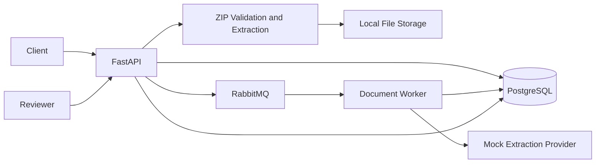
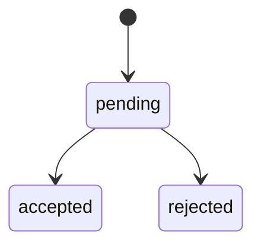

# Design Document – Contract Document Processing System

## 1. Purpose

The system accepts batches of contract documents, schedules asynchronous extraction, persists extracted findings, and allows a reviewer to accept or reject each finding independently.

The design prioritizes clear separation between HTTP request handling, persistence, asynchronous execution, extraction logic, and human review.

## 2. Scope

### In scope

- ZIP upload and archive validation.
- Batch and document metadata persistence.
- Asynchronous document task publication and consumption.
- Mock extraction provider.
- Finding persistence.
- Human review transitions.
- Processing and review progress.
- Retry and dead-letter handling.
- Unit, API, database, broker, security, and workflow tests.

### Out of scope / future work

- Production OCR and LLM-based legal extraction.
- S3/object storage.
- Authentication and role-based access control.
- Full reviewer audit history and re-review workflow.
- Transactional outbox and production-grade orchestration unless implemented separately.
- Multi-region deployment and production observability stack.

## 3. High-level architecture



### Component responsibilities

| Component | Responsibility |
|---|---|
| FastAPI routes | HTTP validation, request/response handling, status codes |
| Batch/document services | Batch creation, document metadata, storage coordination |
| ZIP service | Archive validation and safe extraction |
| PostgreSQL | Batch, document, finding, and processing-attempt persistence |
| RabbitMQ publisher | Publish one task per document |
| RabbitMQ consumer | Consume, acknowledge, retry, and dead-letter tasks |
| Worker task | Claim and process a document |
| Extraction provider | Return structured extracted findings |
| Review service | Enforce review transitions and calculate review statistics |
| Tracking service | Return batch/document status and progress |

## 4. Main processing workflow

1. Client submits a ZIP file and requested extraction variables.
2. API streams the upload to a temporary file subject to configured limits.
3. ZIP service validates archive structure and entries.
4. Accepted files are extracted to a generated batch-specific directory. Generated storage names should be independent of untrusted archive paths.
5. A batch row and document rows are created in PostgreSQL.
6. API publishes one message per document.
7. Worker consumes a message and attempts to claim the document.
8. Worker calls the configured extraction provider.
9. Worker persists findings and processing-attempt outcome.
10. Worker marks the document complete or failed and updates batch status.
11. Reviewer retrieves findings and independently accepts or rejects them.
12. Tracking endpoints calculate processing and review progress.

## 5. Data model

The logical entities are:

### Batch

Represents one uploaded ZIP archive.

Typical fields:

- `id`
- `original_filename`
- `status`
- `total_documents`
- `processed_documents`
- `failed_documents`
- `requested_variables`
- `upload_size`
- `created_at`
- `updated_at`

### Document

Represents one extracted document.

Typical fields:

- `id`
- `batch_id`
- `original_filename`
- `stored_path`
- `file_size`
- `mime_type`
- `status`
- `attempt_count`
- `error_message`
- timestamps

A document belongs to one batch and may have multiple findings and processing attempts.

### Finding

Represents one extracted variable/value pair.

Typical fields:

- `id`
- `document_id`
- `variable_name`
- `extracted_value`
- `status`
- `reviewer_comment`
- `reviewed_by`
- `reviewed_at`
- `created_at`

A uniqueness constraint on `(document_id, variable_name)` prevents duplicate variable findings for a document.

### ProcessingAttempt

Records a processing attempt, including attempt number, status, timestamps, and error details. A uniqueness constraint on `(document_id, attempt_number)` prevents duplicate attempt numbers for a document.

## 6. Asynchronous messaging

The API publishes one task per document. The message body should contain identifiers, not the document contents:

```json
{
  "batch_id": "batch-uuid",
  "document_id": "document-uuid"
}
```

This keeps messages small and allows workers to retrieve document metadata and file paths from PostgreSQL.

### Queue topology

The intended topology contains:

- Main document-processing queue.
- Retry queue with a configured TTL.
- Dead-letter queue for messages that exceed the retry limit.
- Durable exchange and queues.
- Persistent messages.
- Manual acknowledgement.

The exact exchange type, routing keys, queue arguments, and dead-letter bindings must match `app/workers/connection.py`.

### Acknowledgement policy

- Acknowledge after successful processing.
- On a retryable failure, publish to the retry path successfully before acknowledging the original message.
- If retry publication fails, do not acknowledge the original message; allow broker redelivery according to the consumer's error handling.
- Exhausted retries should be recorded as failed and routed to the DLQ.
- Malformed messages need a bounded rejection/dead-letter policy; they must not be requeued forever.

## 7. Extraction provider

The extraction interface separates worker orchestration from the extraction implementation.

The current mock provider:

- Accepts a document path and requested variable names.
- Simulates processing latency.
- Can simulate transient failures.
- Returns structured findings for requested variables.

It is intentionally a deterministic test/demo substitute for a future OCR/LLM provider. Its generated values are not evidence-based and must not be presented as actual legal interpretation.

A production provider could combine file parsing, OCR, an LLM, schema validation, confidence scores, and source-span references.

## 8. Human review workflow

Each finding has an independent state:



The assignment workflow uses a one-way decision: once accepted or rejected, the finding cannot be reviewed again. Invalid transitions should return HTTP `409 Conflict`.

A row-level lock (`SELECT ... FOR UPDATE`) can serialize simultaneous review attempts on PostgreSQL. The second reviewer should observe the committed state and receive a conflict rather than overwrite the first decision.

For production, reviewer identity must come from authenticated context rather than an arbitrary request field. Re-review should be implemented with an append-only review/audit table rather than overwriting the original decision.

## 9. Progress calculations

### Processing progress

```text
(completed_documents + failed_documents) / total_documents * 100
```

Queued and processing documents are not terminal. If the total is zero, progress is zero.

### Review progress

```text
(accepted_findings + rejected_findings) / total_findings * 100
```

Pending findings are not reviewed. If there are no findings, progress is zero.

Batch status should be derived consistently from document outcomes. A mixture of completed and failed documents can be represented as `partially_completed`.

## 10. Reliability, idempotency, and concurrency

RabbitMQ normally provides at-least-once delivery. A worker may receive a task more than once, so processing must be idempotent.

Recommended safeguards:

- Atomic document claim using a database transaction and row lock.
- Skip processing only when the document is already completed.
- Do not acknowledge a duplicate merely because another worker is currently processing unless durable recovery is guaranteed.
- Use a processing lease or claim timestamp so stale `processing` documents can be recovered after a worker crash.
- Enforce unique `(document_id, variable_name)` for findings.
- Enforce unique `(document_id, attempt_number)` for attempts.
- Persist findings and terminal document state transactionally.
- Update batch counters under a row lock or derive them from document rows to avoid lost updates.
- Use independent SQLAlchemy sessions per concurrent task; an `AsyncSession` must not be shared concurrently.

### Transactional outbox trade-off

If the API commits the batch and then publishes RabbitMQ messages, a crash between the database commit and message publication can leave documents that were never queued.

A transactional outbox would write task-publication records in the same database transaction as the batch and documents. A separate publisher would deliver outbox records and mark them sent. This is a recommended production improvement if it is not implemented in the assignment version.

## 11. ZIP security

ZIP files are untrusted input. Validation should include:

- Maximum compressed upload size.
- Maximum number of documents.
- Maximum individual document size.
- Maximum total uncompressed size.
- Compression-ratio limit.
- Supported extensions.
- Rejection of encrypted entries.
- Rejection of symlinks.
- Path traversal checks for both POSIX and Windows path forms.
- Duplicate path checks.
- Manual extraction in bounded chunks to generated filenames.
- Cleanup of temporary files and partial extraction on validation failure.

Extension validation is not equivalent to content validation. File signatures should be checked for supported formats before production use.

## 12. API surface

The intended routes include:

| Method | Route | Purpose |
|---|---|---|
| GET | `/health` | Service health |
| POST | `/api/v1/batches` | Upload a ZIP batch |
| GET | `/api/v1/batches` | List batches |
| GET | `/api/v1/batches/{batch_id}` | Batch details |
| GET | `/api/v1/batches/{batch_id}/documents` | List batch documents |
| GET | `/api/v1/documents/{document_id}` | Document details |
| GET | `/api/v1/documents/{document_id}/findings` | Document findings |
| GET | `/api/v1/batches/{batch_id}/findings` | Batch findings |
| PATCH | `/api/v1/findings/{finding_id}/review` | Accept/reject finding |
| GET | `/api/v1/batches/{batch_id}/summary` | Batch summary |
| GET | `/api/v1/batches/{batch_id}/review-summary` | Batch review statistics |
| GET | `/api/v1/documents/{document_id}/review-summary` | Document review statistics |

The final registered route list in FastAPI Swagger is authoritative.

## 13. Assumptions and trade-offs

| Decision | Reason | Trade-off |
|---|---|---|
| PostgreSQL | Reliable relational persistence and row-level locking | Requires local DB setup |
| RabbitMQ | Decouples upload from extraction | Broker operations and retry topology add complexity |
| Local filesystem | Simple assignment setup | Not shared or highly durable across hosts |
| Mock provider | Allows workflow testing without paid external services | Does not extract actual contract facts |
| One message per document | Enables parallel processing and isolated retries | More broker messages for large batches |
| At-least-once delivery | Practical broker delivery guarantee | Requires idempotent consumers |
| One-way review | Simple and auditable assignment state machine | Re-review requires a separate history model |
| No Docker | Matches local Windows development workflow | Developers install PostgreSQL and RabbitMQ themselves |

## 14. Known limitations

Update this list to reflect the exact final code:

1. Mock extraction does not perform OCR, semantic analysis, or legal interpretation.
2. Local storage lacks object-store durability and cross-worker-host sharing.
3. Without a transactional outbox, a DB-commit/broker-publish gap can leave unqueued work.
4. Worker crash recovery requires a lease or stale-job reaper.
5. Authentication and authorization are simplified or absent.
6. Reviewer audit history and re-review are not implemented in the one-way state model.
7. File extension validation should be supplemented by content-signature checks.
8. Production monitoring, metrics, tracing, alerting, and deployment automation are not included.
9. Retry classification and operational recovery may need further refinement for production workloads.

## 15. Future improvements

- Replace mock extraction with OCR and LLM-backed extraction.
- Add confidence scores, evidence snippets, and source page references.
- Move document storage to S3 or another object store.
- Add transactional outbox and scheduled stale-job recovery.
- Add authentication, RBAC, reviewer audit history, and re-review.
- Add virus scanning and stronger file-content validation.
- Add metrics, distributed tracing, structured audit events, and alerts.
- Add deployment manifests and horizontal worker autoscaling.
